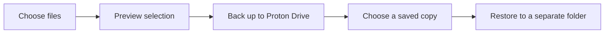
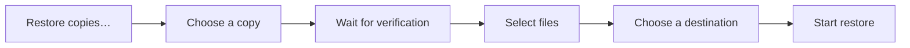
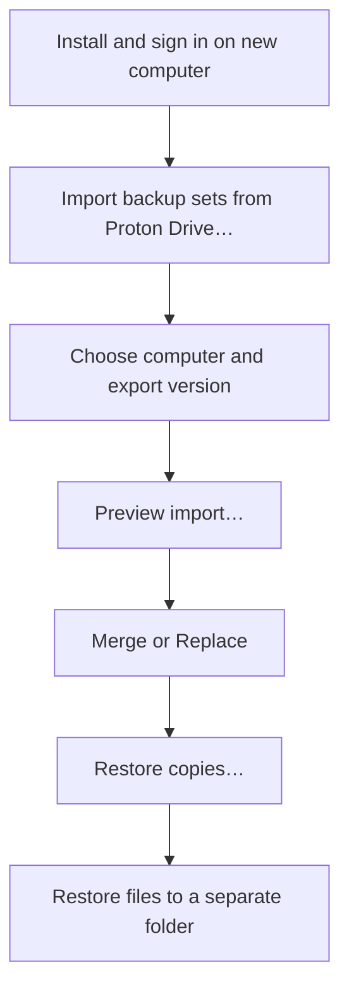

# OmaCustos for Proton Drive

Back up personal files from your Omarchy desktop to Proton Drive. Run backups
yourself or on a schedule, then restore the files you need from an earlier copy.



**Start here:** [Install](#1-install-and-sign-in) → [First backup](#2-create-your-first-backup-set) →
[Test a restore](#3-restore-your-files) → [Save your settings](#4-back-up-your-backup-set-settings)

**After setup:** [Schedules](#5-make-backups-automatic) · [Integrity checks](#6-check-backup-integrity) ·
[Cleanup](#7-manage-history-and-free-space) · [All controls](#8-other-controls-and-settings) · [Help](#9-troubleshooting)

## 1. Install and sign in

On **Arch Linux or Omarchy**, install OmaCustos:

```bash
sudo pacman -S --needed base-devel git
git clone https://github.com/jcergolj/omacustos.git
cd omacustos/pkgbuild
makepkg -Csi
```

Install Proton's official **`proton-drive` CLI** separately using a package or
release source supported by your system. The OmaCustos package does not install it.

Open **OmaCustos for Proton Drive** from your app launcher, or run `omacustos`.
If prompted, press **Sign in to Proton**, complete the browser login, and keep
the terminal open until it finishes. Press **Retry** if needed.

<details>
<summary>Sign-in button not working? Use a terminal</summary>

Run these commands as your normal desktop user, not with `sudo`:

```bash
command -v proton-drive
proton-drive auth login
proton-drive filesystem info /my-files
```

OmaCustos uses the CLI's login session; it never stores your Proton password.
The sign-in button requires `xdg-terminal-exec`, available on Omarchy.

</details>

## 2. Create your first backup set

A **backup set** is a named selection of files, with its own settings and schedule.
A **saved copy** (or restore point) is a version you can restore later.

1. Press **Create your first backup set**, or **top-right ⋯ → New backup set**.
2. Name it, for example **Documents**.
3. Press **+** under **Source files and folders** and choose your files or folders.
4. Leave the defaults for now. Add exclusions if needed (examples below).
5. Press **Preview** and check the **Included**, **Excluded**, **Skipped**, and
   **Missing** lists. Only included files will be attempted.
6. Press **Save**, then **Back up now** on the set's dashboard card.

```text
Example: Projects
├── Sources:       /home/alex/projects
├── Exclusions:    node_modules
│                  vendor
├── Include only:  [blank = everything else]
└── Preview → Save → Back up now
```

> [!TIP]
> Hidden files such as `.env` and `.git` are included. Symbolic links are not
> followed. Check Preview before your first run and after changing your selection.

### What happens on later backups?

| Run | What OmaCustos saves |
| --- | --- |
| First backup | Everything selected: the initial baseline. |
| Files added or changed | New contents; unchanged data is reused. Changed files upload whole. |
| Nothing changed | **Successful check; no saved change** — no new restore point. |

The default location is `/my-files/backups` in Proton Drive. The default history
policy keeps the latest **three saved states**, but extra history is not removed
until you [approve cleanup](#7-manage-history-and-free-space).

## 3. Restore your files

**Try this after your first backup:** restore a small file and open it to check
that your recovery workflow works.



1. Press **Restore copies…** on the backup set's card.
2. Choose a saved copy. Wait for its metadata to be verified and its files to load.
3. All available verified files start selected. Untick anything you do not need;
   folder checkboxes include subfolders.
4. Press **Choose folder…** and select a **separate destination**, such as
   `/home/alex/restore-test`.
5. Press **Start restore**. After success, inspect your files, then press **Done**.

> [!WARNING]
> A restore can replace matching files in the destination. Restore to a separate
> folder first, inspect the result, then copy recovered files back where needed.

| During restore | What to expect |
| --- | --- |
| **Required download** | Selecting one file can require its entire compressed archive. |
| Progress stays still | Large downloads and verification may finish before the file count changes; there is no ETA. |
| **Pause / Resume** | Continue within this app session; a pause is not saved across app restarts. |
| **Stop restore** | Stops safely; already restored files remain. Closing the app also requests a stop. |
| An error occurs | Use **View issues**, then **Back to selection** to retry the full selection. |

### Restore after a reinstall or on another computer

If you exported your settings to Proton Drive, you can recover through the app:



Imported sets stay **paused and read-only**. You can restore without fixing the
old source paths, having local run history, resuming schedules, or taking ownership.
For continuing backups from the new machine, see [writer handoff](#moving-backup-work-to-another-computer).

No settings export available? Preserve `~/.config/omacustos` before reinstalling
if possible. With neither settings nor local configuration, incremental backups
also support [advanced read-only recovery](docs/incremental-restore.md). That path
requires the source-built `omacustos-incremental` tool, which is not in the installed package.

## 4. Back up your backup-set settings

**Do this after setup and whenever you change your sets.** Backed-up files and
backup-set settings are different things:

| Keep safe | Contains | How to save it |
| --- | --- | --- |
| Your files | Documents, photos, projects, etc. | **Back up now** or a schedule. |
| Set definitions | Sources, selection rules, schedules, and settings. | **Top-right ⋯ → Export backup sets to Proton Drive…** or **Export backup sets to file…**. |
| Full local configuration | Definitions, run history, and other local app state. | Preserve `~/.config/omacustos` before reinstalling. Copying it does not grant writer authority elsewhere. |

### Save settings in Proton Drive

Choose **top-right ⋯ → Export backup sets to Proton Drive…** and wait for success.
OmaCustos uploads and reads back the JSON to verify it. Each export is a separate
version under `/my-files/omacustos/settings/<computer>/`; older exports remain.

**Exports are manual, not automatic synchronization.** They contain no backed-up
files, Proton login, writer authority, run history, or global resource preset.
Recovery uses the last successfully exported definitions.

### Export or import a local settings file

- **Export backup sets to file…** saves a JSON file. Keep a copy somewhere you can
  reach without this computer.
- **Import backup sets from file…** loads that file and shows a preview.
- **Merge** updates matching set IDs and keeps unrelated sets. Names alone do not match.
- **Replace** replaces all local set definitions, **not** remote backup files.

Both local and Proton imports stay paused and read-only. Original paths are kept;
OmaCustos does not substitute your new username or home directory.

## 5. Make backups automatic

Click the set's name or **card ⋯ → Edit settings**, choose **daily**, **weekly**,
or **monthly**, and press **Save**. Scheduling starts automatically for normal,
unpaused sets. You can close the app.

```text
Logged in + computer on → Scheduled backups can run
Computer off/logged out → Overdue backups catch up after your next login
```

- If scheduling needs attention, follow the app's fix or press **Enable scheduling**.
- To make a set manual-only, choose **disabled** for its schedule and save.
- Monthly dates missing from a month run on that month's last day.
- Imported sets need an explicit, safe handoff before you can resume backups.

## 6. Check backup integrity

An integrity check verifies stored backup data. It **does not create a backup**
or prove that files excluded from your selection were saved.

| When | What to do |
| --- | --- |
| Normal use | Keep backups running. They advance full integrity checks when due, every 30 days after the last completed cycle. |
| Before relying on old history or approving cleanup | Consider **card ⋯ → Run full integrity check** while you still have your originals. |
| Integrity coverage is unfinished | Run the same action again to resume. A check can need several passes. |
| You suspect damaged remote data | Run a full check and inspect the reported affected restore points. |
| You want to test actual recovery | Restore a sample file too; an integrity check is not a replacement for a test restore. |

Full checks download archives and verify their contents, so allow time, bandwidth,
and staging disk space. The card shows **Checking backup integrity…**; a notification
reports completion or errors, without a percentage or ETA.

> [!IMPORTANT]
> Routine reuse checks can miss same-sized remote corruption. New uploads and
> restores receive full verification. If damage is reported, preserve your local
> originals and inspect the affected history. A new backup can save replacement
> data, but **does not repair old restore points**.

See [integrity details and recovery](docs/incremental-integrity.md) for coverage
limits and handling damaged history.

## 7. Manage history and free space

Use **card ⋯ → Review incremental cleanup…** when prompted or when reviewing old
history. Review the exact proposed deletions before confirming.

```text
Retention policy → Cleanup proposal → Your confirmation → Delete approved scope
                                      ↑
                          No confirmation = no deletion
```

- Saved states share archives. **Do not manually delete individual archives** in
  Proton Drive: more than one restore point may need them.
- Failed or incomplete runs do not evict older successful copies.
- Scheduled runs never approve cleanup themselves. Changed proposals need a new review.
- Unfinished integrity coverage or damaged/unknown health can block cleanup.
- Deleting some old states may not free much space: partly used archives are kept
  whole, not compacted.

| Action | Effect |
| --- | --- |
| **Open latest copy in Proton Drive** | Opens the latest recorded copy in your browser. Use OmaCustos to restore files. |
| **Delete latest copy** | Legacy private-copy folders only; confirms the exact copy before moving it to Trash. Not used for shared incremental snapshots. |
| **Delete backup set** | Removes local settings and its schedule. Remote backup data remains. Export settings first if you may need the set again. |

## 8. Other controls and settings

Expand only what you need. **Top-right ⋯** contains app-wide actions;
**card ⋯** contains actions for one backup set.

<details>
<summary><strong>Choose exactly what gets backed up</strong> — exclusions, include-only rules, Preview</summary>

Open **Edit settings**:

| Control | Use it for |
| --- | --- |
| **Source files and folders → +** | Add folders or individual files, including hidden paths. |
| **Exclusions** | Omit unwanted content, one rule per line. A bare folder name such as `node_modules` excludes matching folders at every depth; a full path targets one location. |
| **Include only** | Narrow a parent folder to matching contents. `.env` selects files with that name at any depth; `.env*` also selects `.env.local`, etc. Leave blank for normal full-folder selection. |
| **Preview** | Review paths and included source size before saving. It neither saves settings nor starts a backup. Run it again after edits. |

Include-only rules support names, paths, and case-sensitive `*` / `?` wildcards
within path segments. Exclusions win. New matching files are picked up on later runs.

[Selection examples](MANUAL.md#back-up-only-specific-files-or-folders-inside-a-parent-folder)

</details>

<details>
<summary><strong>Control a running backup</strong> — Pause, Resume, Cancel, closing the window</summary>

| Control | Effect |
| --- | --- |
| **Pause** | Stops the transfer, releases temporary payloads, and keeps verified progress. Scheduling respects the pause. |
| **Resume** | Re-scans the selection and continues the unfinished copy. New/changed files are included; deleted/excluded files are omitted. |
| **Cancel** | Ends that attempt permanently. The next backup starts a new copy. Run details retain partial remote paths for review. |
| Close the window | The systemd backup worker continues; this is not Pause or Cancel. |

Transient failures retry with backoff. Sign-in, power, and staging problems can
leave a backup waiting for your action. Verified progress is preserved, but a copy
is not restorable until its final metadata and data pass verification.

</details>

<details>
<summary><strong>Understand results</strong> — saved changes, warnings, and run details</summary>

| Result | Meaning / next step |
| --- | --- |
| **New saved state** | A new restore point was saved. |
| **Successful check; no saved change** | No change needed a new restore point. |
| **Incomplete** | A historical result with some verified files and failures. Inspect which files are recoverable; not every incomplete candidate is selectable. |
| **Failed / Retrying / Waiting** | Open **View issues** or **card ⋯ → View latest run details** for paths, reasons, and retry information. |

Run details also show integrity health, last successful check, last saved change,
and capacity warnings. The progress bar counts work/file attempts, not live upload
bytes. A large transfer can remain on one step for a long time.

</details>

<details>
<summary><strong>Advanced settings and resource usage</strong> — destination, retention, power, temporary disk space</summary>

| Setting | When to change it |
| --- | --- |
| Remote folder | You need a location other than `/my-files/backups`. Avoid changing existing repositories casually; see the manual first. |
| Copies to keep | You need more or fewer historical saved states. Cleanup still requires approval. |
| AC power only | Avoid running backups on battery. |
| Staging directory | Temporary disk space is insufficient; choose a disk-backed location outside your sources. Leave blank for automatic selection. |
| Staging budget | Adjust temporary preparation space; the default is 1 GB (`1000000000` bytes). |
| **Resource usage (all backups)** | Reduce CPU/disk priority if backups affect desktop use. Save to apply to the next worker; a running backup keeps its limits. |

Large files stay whole and can exceed the normal staging budget. Free space or
choose another staging disk, save, then **Resume**. RAM-backed locations such as
Omarchy's `/tmp` are rejected. Backups use compressed archives; there is no format
or compression-level selector.

Leave **Use system defaults** checked for normal resource scheduling. Resource
presets apply to all backups, not the desktop UI, and are not in settings exports.

[Storage and staging details](MANUAL.md#advanced-settings) · [Resource usage](MANUAL.md#resource-usage)

</details>

### Moving backup work to another computer

**Only needed to continue writing backups, not to restore files.**

1. Import your settings and correct source paths with **Edit settings**.
2. Permanently disable the old computer's writer: processes, schedules, retries,
   and its ability to restart or access the repository.
3. On the new computer, use **card ⋯ → Offline writer takeover…** for each set.
4. Resolve any reported blockers; do not clear maintenance records to force a takeover.
5. Press **Resume** separately for each imported set when ready.

> [!WARNING]
> Takeover is an offline agreement, not a server-enforced lock. Never let two
> computers write the same set. Taking ownership does not itself start a backup
> or resume its schedule.

<details>
<summary><strong>Templates, appearance, and uninstalling</strong></summary>

- **Top-right ⋯ → Download template** saves an annotated JSON example, even
  offline. Edit full source paths, unique IDs, and schedules, then import it.
  Imported template sets also stay paused and read-only until explicitly handed
  off and resumed. [Template and examples](backup-sets.template.json) ·
  [Generate settings with an LLM](MANUAL.md#generate-an-import-file-with-an-llm).
- **Appearance:** follows the active Omarchy theme automatically; other desktops
  use the system Qt palette.
- **Uninstall:** stop scheduling, then remove the package:

  ```bash
  systemctl --user disable --now omacustos.timer
  sudo pacman -Rns omacustos-git
  ```

  Local configuration, resource settings, and remote backups remain.

</details>

## 9. Troubleshooting

| Problem | First action |
| --- | --- |
| Cannot connect to Proton | Install the CLI or **Sign in to Proton**, then **Retry**. |
| Scheduled backups do not run | Check login/power conditions and press **Enable scheduling** if offered. Imported sets remain paused until handed off and resumed. |
| Expected files are missing | Check **Preview**, include-only rules, exclusions, and **View issues**. |
| Backup is waiting | Open **View latest run details**; resolve sign-in, AC-power, or staging-space requirements, then resume as appropriate. |
| Transfer appears stuck | Check the phase/current file. There is no live byte speed or ETA; large transfers may take time. |
| Restore or integrity check fails | Keep originals, inspect **View issues** or reported errors, and retry after resolving the cause. |

For worker logs:

```bash
journalctl --user -u omacustos.service
```

**Limits:** OmaCustos backs up selected files, not system images or live databases.
Capture is file-by-file, not an atomic filesystem snapshot. Stop applications or
export their data first when they need a consistent multi-file backup.

[Full user manual](MANUAL.md) · [Troubleshooting details](MANUAL.md#troubleshooting) ·
[Technical notes, builds, and development](TECHNICAL.md)
