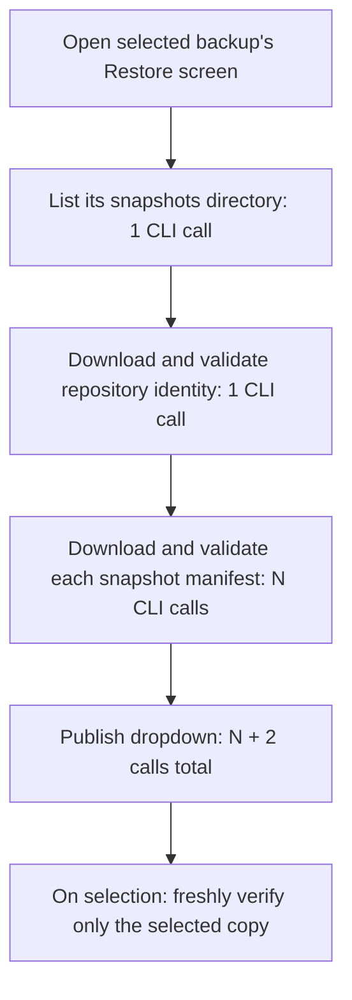

# Why the Restore dropdown takes so long

## Current result: batch selected-copy metadata in one CLI process

The selected-copy delay still came from remote calls, not file-tree processing.
A fresh read-only trace measured **5,431 ms** for three serial metadata calls and
**2 ms** for exact-response local replay. A later unchanged-binary baseline took
**8,077 ms**, illustrating the cloud latency variation behind the reported wait.

`IncrementalRestore::verifyCopy` now downloads the selected repository's
`repository.json` and snapshot's `manifest.json` together using the documented
multi-source `filesystem download path... localFolder` command. Both records
still undergo fresh identity, schema and provenance validation before archive
metadata is accepted or any entries are published. Providers without batch
support retain their existing serial path. The chooser remains one request;
selection with complete bulk archive metadata falls from **three CLI calls to
two**, independent of the number of referenced archives.

Three live traces of the same 28-file point measured **4,053 ms**, **4,804 ms**
and **5,280 ms** for selection, with two calls and **2 ms** local replay each. These are individual
observations, not a percentile or guaranteed speedup. The two-second diagnostic
budget **still fails**: batching removes one process/authentication/path-setup
boundary but does not eliminate the remaining cloud work. No persistent cache,
stale verification shortcut, remote writes or background prefetch was added.

### Rejected experiment: concurrent CLI processes

Three independently owned runners reduced some selections to 2,642–3,734 ms,
but live testing also reproduced early failures containing database/lock errors.
One failed bulk listing then triggered individual metadata fallbacks and took
6,216 ms. The parallel experiment was removed; the final implementation keeps
the existing single-operation, single-CLI-process execution model. Offline
overlap tests alone were not sufficient evidence of real CLI compatibility.

### Regression evidence

The request-count regression first failed with **three calls instead of two**.
Coverage now asserts the exact paired metadata paths, cancellation immediately
after the batch, bulk-list fallback, missing/changed archives, fresh verification
gating, metadata/provenance rejection, one-command download output, partial
transfer cleanup, basename collisions and preservation of existing local files.
The paired-read/cancellation regression passed **20/20 repeated offline runs**.
The subprocess worker fixture previously handled only the final download source;
it now accepts the CLI's multi-source contract too. Both manual and scheduled
worker/restore integration rows passed after that fixture correction.

Final validation: `cmake --build build -j2` succeeded, and
`env TMPDIR=/tmp/opencode ctest --test-dir build --output-on-failure -j2`
passed **41/41 targets** in **361.21 seconds**. `git diff --check` passed.

The read-only probe is `/tmp/opencode/restore-batch-latency-probe.cpp` (and its
matching executable). Responses stay in memory; output contains roles/counts
and timings rather than names, remote paths, IDs or credentials.

## Previous result: candidates first, bulk archive verification

The user approved showing unverified restore-point candidates before downloading
their manifests. Normal selected-backup browsing now uses
`IncrementalRestore::listSnapshotCandidates`: one safe, scoped directory listing.
Candidates are labelled **not verified** and use a provisional **folder date**.
Missing/incomplete points can appear, but listing never makes them restorable.
Selection still freshly validates repository identity, manifest schema/provenance
and archive metadata before enabling Restore. The validated `listSnapshots` and
`BackupCatalog::listHistory` APIs remain available internally.

Archive metadata checks now reuse the existing operation-local
`RemoteMetadataCache`, obtaining content sizes in one directory listing where
supported. Missing, ambiguous or storage-only metadata falls back to individual
inspection; trusted checksum requirements remain unchanged. No archive bytes are
downloaded for browsing, and actual restores retain full hash/inventory checks.

A read-only trace of two points, 3,933 files and 14 referenced archives measured:

| Boundary | Before | After | Requests before → after |
| --- | ---: | ---: | ---: |
| Initial point list | 11,321 ms | 1,248 ms | 4 → 1 |
| Selected point's verified file list | 37,987 ms | 7,545 ms | 16 → 3 |

Cloud timings are individual observations, not percentile guarantees. File loading
still exceeds the diagnostic two-second budget because its three fresh metadata
requests remain serial. Exact-response replay after the change took 0 ms for the
candidate list and 255 ms for selection at millisecond resolution. An offscreen
Qt Quick probe displaying the captured file paths built 5,147 tree rows in 117 ms
synchronously and reached its next rendered frame in 125 ms. It measures Qt's
offscreen rendering, not physical display latency; rendering was not the observed
multi-second bottleneck.

The controller regression first failed at four calls instead of one, and shared
archive verification failed at five calls instead of three for a three-archive
fixture. Coverage also checks incomplete/malformed candidates, foreign identities,
restore-eligibility gating, bulk fallback, unavailable archives, cancellation and
preserved internal validated-history behavior.

Validation after rebuilding all targets: **41/41 CTest targets passed** in
238.53 seconds. The controller target has 55 passing cases and incremental restore
has 46; the candidate UI and captured-tree rendering probes also passed.

Temporary diagnostic sources are `/tmp/opencode/restore-selection-latency-probe.cpp`
and `/tmp/opencode/restore-ui-probe/tst_restore_render.qml`. They are not installed
application commands. The network probe permits only read-only filesystem calls;
raw responses remain in memory and paths/credentials are not printed.

## Previous result: validated manifests before listing

Selected-backup history now reads only that backup's incremental snapshots.
Old-format copies are intentionally excluded from the chooser, as agreed; no
remote copies are deleted. General discovery, legacy readers, retention, and
selected-copy verification remain available internally.



For the same two live restore points, the updated diagnostic measured:

| Work | Time |
| --- | ---: |
| List selected set's snapshots | 1,128 ms |
| Download repository identity once | 2,030 ms |
| Download first manifest | 2,777 ms |
| Download second manifest | 2,071 ms |
| **Controller listing total** | **8,012 ms** |

Exactly **4 CLI calls**, **2 restore points**, **0 errors**. Replaying the same
responses locally took **4 ms**; reopening the loaded context took **0 ms** at
millisecond resolution with no requests. The original trace below took 27,472 ms.
These are individual cloud traces, not a guaranteed latency reduction; the updated
path still exceeds the diagnostic two-second budget. No persistent local cache
or new remote index was introduced.

The offline CLI regression initially failed with **15 calls instead of 4** on a
mixed-history fixture, then passed with four after the implementation. It also
checks fresh verification on selection, zero-request same-context reopening,
four-request refresh, and that ignored legacy copies remain on disk.

The implementation lives in `IncrementalRestore::listSnapshots`, reached through
`BackupCatalog::listHistory` when the controller supplies a shared set ID. It
reuses the private manifest/provenance loader, with the validated identity scoped
to this single operation. Independent Standards and Spec reviews reported no
findings. Regression coverage includes malformed repository identities and
manifests, unsafe roots and snapshot entries, cancellation, identity refresh,
missing snapshot manifests, and preserved legacy-format compatibility readers.

Final validation: `cmake --build build -j2` passed.
`env TMPDIR=/tmp/opencode ctest --test-dir build --output-on-failure -j2`
passed **all 41 test targets** in **396.48 seconds**, including the dashboard,
worker recovery, legacy compatibility, incremental restore, and four-call
controller regression suites. `git diff --check` also passed.

## Original investigation (before this implementation)

## Finding

**The bottleneck is serial Proton CLI work during history discovery, not dropdown
rendering or C++ container processing.** On 2026-10-24, listing two restore points
for the first locally configured backup took **27.472 seconds**. Its 14 CLI calls
accounted for **27.457 seconds**, or approximately **99.95%** of the measured time.

The original investigation measured the working tree including its pre-existing
uncommitted restore optimizations, before the implementation summarized above.
Backup names, remote paths, identifiers, credentials, and raw CLI responses are
omitted from this report.

## Original flow

```mermaid
sequenceDiagram
    actor User
    participant UI as Main.qml / RestorePanel.qml
    participant Controller as BackupRestoreController
    participant Catalog as BackupCatalog
    participant Incremental as IncrementalRestore
    participant CLI as ProtonProvider / proton-drive

    User->>UI: Restore copies…
    UI->>Controller: discover(configured root, set ID, history=true, refresh=false)
    alt Successful list already loaded for the same context
        Controller-->>UI: Reuse cached list, no CLI calls
    else First open / refresh / different context
        Controller->>Catalog: listHistory(root, expected shared set ID)
        Note over Controller,Catalog: Background task; only one controller operation at a time
        Catalog->>CLI: list root
        Catalog->>CLI: list sets
        loop Repository directories, serially
            Catalog->>CLI: list repository directory
            alt Selected repository
                Catalog->>CLI: list snapshots directory
                loop Each saved snapshot, serially
                    Catalog->>CLI: list snapshot directory
                    Catalog->>Incremental: describeCopy(snapshot)
                    Incremental->>CLI: download repository.json
                    Note over Incremental,CLI: Same anchor downloaded again for each snapshot
                    Incremental->>CLI: download manifest.json
                    Incremental->>Incremental: Validate manifest and provenance
                end
            else Other repository
                Note over Catalog,CLI: Pruned AFTER its directory listing
            end
        end
        Catalog-->>Controller: Entire discovered list
        Controller-->>UI: copiesChanged; populate ComboBox
    end
    User->>UI: Select a restore point
    UI->>Controller: selectCopy(index)
    Note over Controller,CLI: Separate phase: reload metadata and verify selected copy payloads
```

The dropdown is bound to `controller.copies`. There is no incremental publication
while discovery is running: first-open options arrive when the complete task
finishes. Moving work to a background thread keeps the UI responsive, but does
not shorten the wait for those options.

## Measured evidence

A temporary, read-only C++ harness links the same `omacustos-controllers` and
`omacustos-core` libraries as the application. It invokes the real controller
without QML, using the configured Proton binary and the first configured backup.
Its runner permits only `filesystem list`, `info`, and `download`.

The harness records CLI duration and keeps responses and downloaded metadata in
memory. A fresh controller then replays exactly the same requests and bytes
without launching the CLI. Replay still executes provider JSON parsing, manifest
validation, catalog traversal, sorting, and controller publication.

| Scenario | CLI calls | Restore points | Time |
| --- | ---: | ---: | ---: |
| Normal configured-root discovery | 14 | 2 | 27,472 ms |
| Exact-response local replay of normal discovery | 0 | 2 | 5 ms |
| Same-context reopen after normal discovery | 0 | 2 | 0 ms at millisecond resolution |
| Discovery rooted at this set's `snapshots` directory | 7 | 2 | 17,294 ms |
| Exact-response local replay of narrowed discovery | 0 | 2 | 5 ms |
| Same-context reopen after narrowed discovery | 0 | 2 | 0 ms at millisecond resolution |

The narrowed experiment changes only the discovery root supplied to the
controller; production code is unchanged. It proves seven calls can be avoided
for these two incremental snapshots. It is **not** a complete replacement for
mixed legacy/incremental history discovery.

Both cloud runs exceeded a diagnostic 2,000 ms dropdown-loading budget. This is a
diagnostic threshold, not an existing project requirement. Cloud latency varies;
these are individual traces, not a percentile benchmark. Do not interpret the
10.178-second difference as a guaranteed optimization speedup.

### Where the original 27.457 seconds of CLI time went

| Work | Calls | Total |
| --- | ---: | ---: |
| List configured root and `sets` | 2 | 3,037 ms |
| List selected repository and its `snapshots` directory | 2 | 3,124 ms |
| List the two snapshot directories | 2 | 2,290 ms |
| Download the same `repository.json` twice | 2 | 5,877 ms |
| Download the two snapshot manifests | 2 | 4,951 ms |
| List four unrelated repository directories | 4 | 8,178 ms |
| **Total** | **14** | **27,457 ms** |

Both restore points had already been described before the final four unrelated
repository listings. The controller nevertheless waited another **8.178 seconds**
before publishing the dropdown list.

The anchor was only **261 bytes**; the manifests were **10,554** and **11,038
bytes**. Small metadata downloads still took seconds. These timings include CLI
startup and everything the CLI does internally; they do **not** isolate network,
authentication, cryptography, or process startup from one another.

No archive payload was downloaded or inspected to fill the dropdown. Archive
verification after selecting a restore point is a different latency boundary.
The probe does not measure QML painting or physical screen presentation, but it
reproduces the long wait before the UI can receive its model.

## Code locations responsible

| Location | Responsibility |
| --- | --- |
| [`Main.qml:127–151`](../native/qml/Main.qml#L127) | Opens restore with history mode and navigation-cache reuse. |
| [`backupsetcontroller.cpp:607–615`](../native/src/backupsetcontroller.cpp#L607) | Supplies the entire configured remote root, not the selected set's snapshot directory. |
| [`backuprestorecontroller.cpp:321–381`](../native/src/backuprestorecontroller.cpp#L321) | Same-context cache check and discovery setup. |
| [`backuprestorecontroller.cpp:421–458`](../native/src/backuprestorecontroller.cpp#L421) | Runs `listHistory`, then filters returned copy identities. |
| [`backupcatalog.cpp:43–93`](../native/src/backupcatalog.cpp#L43) | Recursive serial traversal; another repository is recognized and pruned only after listing it. |
| [`backupcatalog.cpp:129–136`](../native/src/backupcatalog.cpp#L129) | Dispatches incremental snapshots to metadata-only `describeCopy`. |
| [`incrementalrestore.cpp:74–94`](../native/src/incrementalrestore.cpp#L74) | Downloads and validates the repository anchor and manifest for every snapshot. |
| [`backuprestorecontroller.cpp:39–90`](../native/src/backuprestorecontroller.cpp#L39) | Publishes copies only when the complete background task finishes. |
| [`protonprovider.cpp:352–356`](../native/src/protonprovider.cpp#L352) | Each directory listing invokes the CLI. |
| [`qprocessrunner.cpp:41–76`](../native/src/qprocessrunner.cpp#L41) | Starts a fresh subprocess and waits for it on the background thread. |
| [`RestorePanel.qml:143–157`](../native/qml/RestorePanel.qml#L143) | Binds the dropdown to the controller list; activation starts separate verification. |

## Changes considered during diagnosis

Items 1–3 informed the implementation. The user chose to skip old-format copies
in the normal chooser rather than add separate legacy discovery. Items 4–5 were
not implemented.

1. **Separate selected-set browsing from full-root discovery.** Derive the known
   incremental repository from the selected set ID and list its snapshots
   directly. Preserve historical v1–v3 copies through a scoped legacy path or
   explicit broader discovery. Do not silently drop historical copies.
2. **Read the repository anchor once per listing operation.** Reuse that validated
   identity across snapshots of the same repository, while validating each
   snapshot against it. Do not make ownership metadata permanently trusted or
   reuse listing metadata as authorization to restore or delete.
3. **Avoid listing inside every snapshot just to find its manifest.** The snapshot
   directory listing already gives candidate snapshot paths; read each exact
   `manifest.json` and handle missing/incomplete candidates safely. Preserve the
   existing provenance, identity, and path validation.
4. **Publish usable results before unrelated discovery finishes.** If broad legacy
   discovery remains necessary, show validated selected-set results first and
   merge subsequent results by stable copy path. Keep restore eligibility behind
   fresh selected-copy verification.
5. **Only then consider bounded concurrent metadata fetches.** The existing
   controller intentionally serializes provider calls. Increasing its thread
   count blindly risks shared state and navigation/restore correctness. Any
   concurrency needs independently owned runners/providers, cancellation, and
   generation-safe publication.

For this two-snapshot incremental example, direct snapshot listing, one shared
anchor read, and two manifest downloads would require **4 CLI calls instead of
14**, excluding any separate legacy discovery or existence probes. This is a
request-count estimate, not a measured implementation or a promise of subsecond
loading: even four serial CLI calls may still take several seconds.

The existing working-tree changes already avoid descending into object and
bookkeeping trees and reuse a loaded list when reopening the same context.
They do not eliminate the first-open scan measured here. Switching contexts or
restarting is not equivalent to the measured same-context cache hit.

## Validation and diagnostic artifacts

Session-local harness source and executable:
`/tmp/opencode/restore-browse-probe.cpp` and
`/tmp/opencode/restore-browse-probe`. These are temporary diagnostic artifacts,
not installed application commands. They retain no raw response capture on disk.

```sh
env TMPDIR=/tmp/opencode /tmp/opencode/restore-browse-probe 0
# SUMMARY ... cloud_ms=27472 cli_ms=27457 calls=14 copies=2 failed=0
# ... reopen_ms=0 reopen_calls=0 replay_ms=5 replay_copies=2 replay_failed=0
# DROPDOWN_BUDGET_2000MS=FAIL (exit 2)

env TMPDIR=/tmp/opencode /tmp/opencode/restore-browse-probe 0 snapshots
# SUMMARY ... cloud_ms=17294 cli_ms=17284 calls=7 copies=2 failed=0
# ... reopen_ms=0 reopen_calls=0 replay_ms=5 replay_copies=2 replay_failed=0
# DROPDOWN_BUDGET_2000MS=FAIL (exit 2)

env TMPDIR=/tmp/opencode QT_QPA_PLATFORM=offscreen build/backuprestorecontroller-test
# Totals: 49 passed, 0 failed; 6988 ms
```

The initial tests established listing/verification separation, safe supersession,
and cache behavior; they did not impose a cloud-loading performance budget.
The implementation adds a deterministic four-CLI-call regression, not a cloud
timing guarantee.
